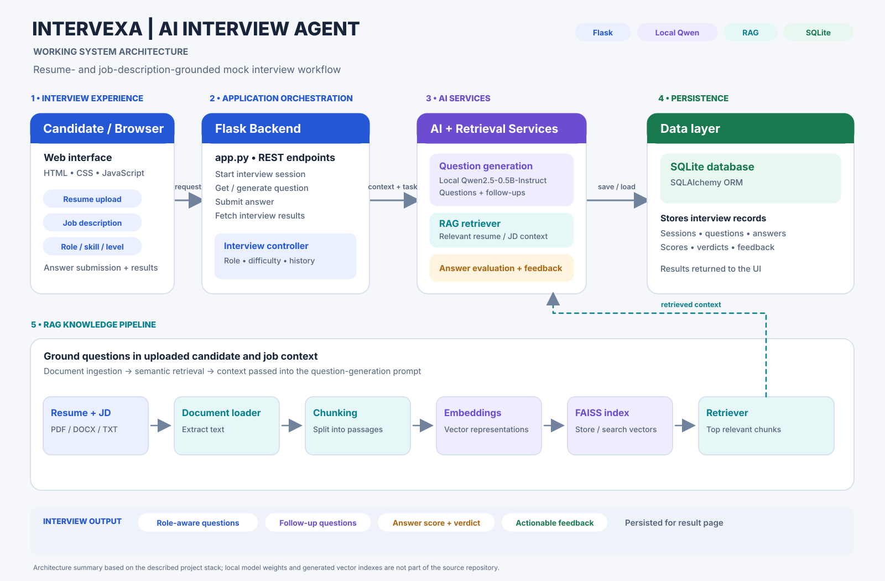

# Intervexa - AI Interview Agent

An AI-powered mock interview application using a local Qwen model and Retrieval-Augmented Generation (RAG).

## System Architecture

## 🖥️ Application Preview

### Home Page

### Dashboard

### Interview Setup

### Live Interview

### Interview Details

### Interview Results

